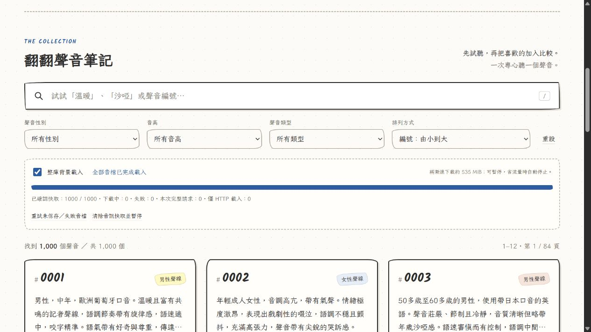

# 整庫漸進載入與持久快取驗收 — 2026-10-15

**本機修改、測試與驗收完成；沒有 commit、push 或更新正式 GitHub Pages。**

## 交付結果

原有唯一的 `BreezeAudioLoader` 已改為完整索引佇列，不再使用前兩個候選、目前分頁或比較清單作為整庫限制。預設並行 2 個，播放時降為 1 個並持續處理其餘項目；每筆完成後自動接續下一筆。

**真實 Chromium 瀏覽器測試：1,000 個原始 WAV 均完成 Cache Storage 保存，0 失敗、0 僅 HTTP 載入。**
重新整理後，啟動檢查恢復 **1,000／1,000 已確認快取，本次完整請求 0**。這是本機測試 origin 的結果，不代表尚未部署的正式網址或所有訪客裝置都已快取。

停止本機測試伺服器後，仍成功播放第 1000 個 WAV：來源為 Blob URL、長度 6.64 秒、狀態「播放中」，全頁只有 1 個 audio。Blob 來自 Cache Storage 回讀的單一音檔，沒有重新請求伺服器。

## 修改檔案

| 檔案 | 本次變更 |
|---|---|
| `assets/js/audio-loader.js` | 同一管理器內改為整庫佇列、Cache Storage、SHA256 驗證、容量估算、有限重試、前景搶先及命名空間清理。 |
| `assets/js/app.js` | 初始化完整索引、整庫進度、播放狀態優先級、暫停／恢復、重試及清除操作。保留 playVersion 競態保護與既有功能。 |
| `index.html` | 整庫控制、已確認快取進度、完整請求／失敗等數量、儲存警告。JS/CSS 使用固定資產版本，WAV URL 不加 query。 |
| `assets/css/style.css` | 原手繪風格中的進度與操作區，藍色進度條及行動版換行。 |
| `tests/audio-loader.test.cjs` | 更新為 17 項載入／快取測試，包含真正跑完 1,000 個模擬項目。 |
| `README.md` | 整庫操作、Cache Storage、容量／淘汰、版本與測試說明。 |
| `LIBRARY_CACHE_VERIFICATION.md` | 本次實測報告。 |
| `docs/library-cache-preview.png` | 最終瀏覽器截圖，顯示重新整理後的 1000／1000。 |

沿用現有 GitHub Actions 的 Node 24 語法／測試與 Pages 打包流程，沒有新增後端。開始本次工作前已存在的未提交修改與舊版報告均保留，沒有重設工作區。

## 實際快取機制

一般下載仍用同源原 URL 和 HTTP cache default。正式 Pages 的 0001 WAV 本次實際 HEAD 為 200，Cache-Control `max-age=600`、Accept-Ranges `bytes`、Content-Length 453200。HTTP 快取無法證明整套 535 MiB 長期存在，因此新增 **Window Cache Storage；沒有 Service Worker 或 IndexedDB**。

每筆網路回應完整下載後，核對索引大小與 SHA256；Cache Storage put 完成後，再 match 核對版本與大小標記，才增加已確認快取。重新整理逐筆核對 cache entry，不信任 localStorage 記錄；播放時回讀單檔並再次驗證內容。Cache Storage 與 HTTP 快取分開，HTTP `max-age=600` 到期不會自動使這些已驗證的 Cache Storage entries 失效。

Cache 名稱綁定專案部署子路徑與 schema 版本。索引 SHA 改變時失效該 entry，重新驗證／下載，避免重用舊的 HTTP 內容；不變的 999 個檔案不需重抓。只清理本專案命名空間的過時項目，保留同 origin 的其他應用程式快取。

背景僅同時持有少量回應，成功後釋放記憶體。只有使用者選中的音檔轉成 Blob URL，切換／關閉即 revoke；不把整庫 1,000 個 Blob 留在 JavaScript。已確認的音訊內容共 560,581,760 bytes，儲存系統另有中繼資料開銷。

## 12 項要求的驗證

| 要求 | 實際驗證 |
|---|---|
| 1. 全部 1,000 個進入佇列 | 自動化測試建立並處理完整 1,000 個 URL；真實網站讀取原索引並保存 1,000 個 WAV。 |
| 2. 持續前進至整庫完成 | 本機真實瀏覽器由 0 前進至 378，再至 1000／1000；沒有使用者逐頁瀏覽。慢速測試另持續到至少 99 個，明確超過前 2 個與當頁 12 個。 |
| 3. 並行不超上限 | 自動化測試確認背景最多 2 個；播放／弱網路／背景頁面最多 1 個。真實 UI 下載中顯示 2，播放搶先時取消原背景工作。 |
| 4. 前景最高優先 | 每筆延遲 2 秒的實際 HTTP 測試中，背景 23、24 取消後，0900 前景立即開始；不等待其完成。啟動時也不必等整庫快取掃描結束，另有測試覆蓋。 |
| 5. 同檔不重複下載 | 自動化測試將同一背景工作提升為前景，共用 job；只呼叫一次 fetch。已持久保存項目直接讀 Cache Storage。 |
| 6. 舊請求不覆蓋新選擇 | 慢速瀏覽器連續選 0900→0901→0902，前兩個請求取消，最後 #0902 播放中。管理器 selection 與 app playVersion 均保留防護。 |
| 7. 有限重試並跳過 | 自動化測試中，404 項目最多 3 次，該筆失敗、其他 9 筆成功保存；沒有無限重試。 |
| 8. 暫停與恢復 | 自動化與真實 checkbox 測試通過；已成功保存數保留，恢復後續處理。清除測試命名空間後為 0／1000，下載中 0，保持暫停。 |
| 9. 離線後恢復 | 自動化測試確認 offline 暫停，online 後處理完剩餘項目；網路失敗與 404 分開處理。真實停止測試伺服器後，已保存的 WAV 仍可播放。沒有宣稱已切換作業系統 Wi-Fi 測試。 |
| 10. 配額不足仍可播放 | 自動化注入 QuotaExceededError：confirmed 0、HTTP-only 10、requested 10，complete false，前景仍能播放。沒有故意填滿使用者磁碟測試真實配額耗盡。 |
| 11. 優先讀已保存資料 | 重新整理後讀到 1000／1000、本次完整請求 0；播放 0002、1000 的 debug 為 persistent-hit。停用測試伺服器後，1000 仍以 Blob URL 播放。 |
| 12. 真正完成顯示 1000／1000 | 最終畫面顯示「全部音檔已完成載入」、已確認快取 1000／1000、下載中 0、失敗 0、僅 HTTP 載入 0；progress 的 value 屬性為 1000。 |

自動化測試用小型模擬資料和測試 Cache API 驗證排程，不能冒充實際 WAV 快取。上述真實 1,000 個 WAV 的驗證另在瀏覽器原生 Cache Storage 執行，兩者明確區分。

## 原有功能與檔案檢查

本次回歸測試：搜尋「沙啞」再選女性為 85 筆、進度跳至 0:04／0:08、音量調整、比較視窗播放與原檔下載成功。下載的 0001 WAV 與 output 原檔 SHA256 一致。全頁只有 1 個 audio。分頁、排序與既有卡片繼續使用原實作，切換列表不會限制整庫佇列。

- 兩個 JS 的 `node --check`：通過。
- `node --test tests/audio-loader.test.cjs`：17 項通過，包含 1,000 個項目的整庫終結、Quota、版本失效及啟動掃描期間前景優先。
- `python -m unittest discover -s tests -v`：4 項原索引測試通過。
- `python scripts/generate_voice_index.py --check`：1,000 個 WAV、大小、SHA256 及索引一致，通過。
- `python scripts/build_site.py`：成功；最終 staging 與修改後 HTML/JS/CSS 逐檔核對一致。沿用同一白名單網站內容，不包含模型、虛擬環境或測試快取。

data/voices.json、metadata/voices-source.json、原音檔 manifest 與修改前 SHA256 一致；原 WAV 未更動。沒有建立第二個 Git Repo、沒有改 remote、沒有執行 TTS。

## 容量、相容性及已知限制

開始時以 storage.estimate() 估算容量，保留約 16 MiB 餘裕；估算不能取代實際 put 的成功結果。可用量不足或寫入失敗，會提示並繼續 HTTP 處理其他音檔，未保存者不計入 confirmed，也不顯示全部已快取。使用者可釋放空間後重試。沒有自動淘汰已完成的當期音檔來反覆下載整庫。

Cache Storage 仍受瀏覽器配額、清除網站資料、私密模式、儲存壓力與淘汰政策影響，不能保證永久保存。若必要 API／安全環境不可用，會降級為 HTTP-only 或直接手動播放並清楚顯示限制。saveData 暫停自動下載；慢網路降速但不限制總數。頁面凍結或關閉後不保證繼續執行，下次開啟依實際已保存內容恢復。

本次完整瀏覽器測試在 Chromium／localhost 執行，沒有假稱已驗證 Safari、真實 iOS 或私密模式。正式 GitHub Pages 本次僅檢查現有標頭；新程式尚未推送，正式網址的新整庫行為仍待發布後驗收。

瀏覽器工具不能直接操作 DevTools Network 面板；本次使用 UI、Cache Storage 實際讀寫結果、debug 與測試服務交叉驗證。debug 工具記錄有筆數上限；Windows 測試服務並行文字記錄亦不作為全部 1,000 個成功的唯一依據。完整保存判定以 put／match、重新整理逐項恢復與停用伺服器後的回讀為準。

參考：[Cache Storage 可由 Window 使用](https://developer.mozilla.org/en-US/docs/Web/API/CacheStorage)、[StorageManager.estimate](https://developer.mozilla.org/en-US/docs/Web/API/StorageManager/estimate)、[配額與淘汰政策](https://developer.mozilla.org/en-US/docs/Web/API/Storage_API/Storage_quotas_and_eviction_criteria)。

## 畫面

本次保持本機修改狀態，沒有擅自推送。若日後決定發布，README 已保留對既有 origin 的明確 Git 命令。
