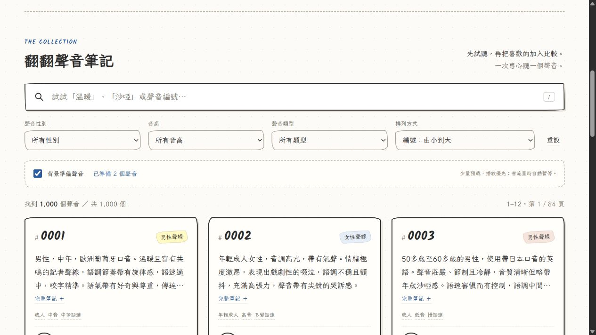

# 智慧背景預載驗收 — 2026-10-15

**現有專案已修改，本機瀏覽器與程式檢查通過；尚未 commit / push 或部署本次修改。**

## 修改檔案

| 檔案 | 變更 |
|---|---|
| `index.html` | 載入管理器腳本、背景準備聲音開關及狀態。 |
| `assets/js/audio-loader.js` | 新增唯一載入管理器、排程／取消／共用請求、短暫 Blob 與 HTTP 快取交接。 |
| `assets/js/app.js` | 接入既有播放器、分頁／比較清單、播放優先、快速切換競態保護與偏好保存。 |
| `assets/css/style.css` | 保留手繪風格，新增響應式預載控制區。 |
| `tests/audio-loader.test.cjs` | 9 項可重跑的排程與容量測試，使用 Node 內建測試工具，無 npm 套件。 |
| `.github/workflows/deploy-pages.yml` | 使用 Node 24 跑 JS 語法與排程測試；保留既有 Pages 打包部署。 |
| `README.md` | 新增操作方式、容量／相容性限制、既有 Repo 推送指令。 |
| `PRELOAD_VERIFICATION.md` | 本報告。 |
| `docs/preload-preview.png` | 實際新版介面截圖。 |

## 使用與限制

搜尋篩選區下方的 **「背景準備聲音」** 為預載開關。勾選時在頁面穩定約 850 ms 後準備當頁前 2 個候選，背景最多 1 個並行；播放期間最多準備下一個。取消勾選立即取消背景工作，不影響手動播放。儲存偏好不可用時也正常運作。

播放優先於其他載入；已在下載中的同一檔案提升為播放任務，共用原 Promise；其他工作取消。已準備好的短暫 Blob 直接交給原來唯一的 audio 元素，避免 fetch 完成後立即由 media Range 再次下載。其他聲音不會同時播放。

短暫 Blob 上限 3 個、合計 6 MiB，60 秒到期；播放器仍使用的檔案保留至切換／關閉。背景候選大小最多 2 MiB（現有所有 WAV 均符合）；釋放時 revokeObjectURL。隱藏頁面取消背景並釋放非目前使用的 Blob；離開頁面全部釋放。進行中的網路回應／解碼可能另使用短暫記憶體，6 MiB 是保留 Blob 的預算。

一般請求使用相同音訊 URL、cache default、same-origin；沒有隨機 cache-busting 參數。過期 Blob 後再播放會讓瀏覽器自行檢查 HTTP 快取，而不是把「曾載入」當作檔案仍存在的保證。手動按重試使用 cache reload，避免長時間停留在被快取的失敗回應。

saveData、弱網路、離線、頁面隱藏會暫停背景；3g 最多 1 個候選。connection API 不存在時維持 2 個候選／1 個並行。缺少必要載入 API 時背景關閉，播放器直接使用 WAV URL。預載失敗不阻擋其他候選，不無限重試；手動播放失敗仍可重試。

沒有 Service Worker、Cache Storage、外部音訊服務、第二個 Repo，沒有 1,000 個 audio 元素或 1,000 個常駐 Blob。瀏覽器快取可能被清除；少數瀏覽器可能要求非同步載入後再按一次播放，介面會提示。

## 十項實測

| 驗收項目 | 結果與證據 |
|---|---|
| 首頁不下載全部音檔 | 新的 `/cold-preload/` HTTP 路徑，背景開啟後只收到 0001、0002 兩個 WAV GET，皆 200。沒有整庫下載。 |
| 初始數量上限 | 真實瀏覽器顯示「已準備 2 個聲音」，伺服器記錄只有 2 個請求；程式測試亦將 1,000 候選限制為 2 個。 |
| 播放優先／共用請求 | 以每筆延遲 2 秒的測試服務載入 0001，播放按鈕後記錄 promote，只有原請求，沒有第二次下載。13 號背景下載被取消時，20 號前景請求同一時間開始。 |
| 再次播放使用快取 | 0001 首次完成的 Resource Timing 為 transferSize 453500、encodedBodySize 453200；Blob 過期後重新播放，transferSize 0、encodedBodySize 453200、delivery http-cache。測試服務同一路徑沒有第二個 GET。短時間換回 0023／0024 另觀察到 memory-hit，明確區分兩種命中。 |
| 分頁不整批重載 | 第 2 頁顯示 13–24；只規劃當頁前 2 個或播放時的下一個。待辦舊項目取消；同一頁已完成項目不反覆背景抓取。 |
| 快速切換 | 真實瀏覽器連續點 0020→0021→0022→0023，前 3 個前景工作依序 abort，最後 0023 播放中，全頁只有 1 個 audio。測試另以連續 20 次切換驗證僅 1 個未取消工作。 |
| 關閉後手動播放 | 取消勾選後顯示「已關閉背景預載」，頁面切換仍保留關閉；手動載入、暫停、進度跳至 0:02、音量、比較播放均成功。 |
| 失敗不崩潰 | 測試服務故意回 404，介面顯示 HTTP 404；手動重試後恢復播放。離線／saveData／2g 等策略與失敗候選不中斷下一候選經單元測試驗證；沒有假稱已實測真實瀏覽器離線切換。 |
| 原功能回歸 | 沙啞＋女性結果 85 筆；排序、分頁、比較 2 個聲音並播放、原 WAV 下載通過。行動版控制區寬度約 339 px，390 px 視口沒有水平溢出。 |
| 正式 GitHub Pages | 已在正式網址真實播放 0001 至結束，長度 4.72 秒；HTTP HEAD 200，正式 WAV 回 Cache-Control max-age=600、Accept-Ranges bytes，實際 Range bytes=0-63 回 206、64 bytes。**正式站仍是推送前版本；新版預載／快取功能在正式 URL 的驗收須待本次修改部署後進行。** |

## Network 工具的實際限制

本次瀏覽器工具沒有 DevTools Network 面板控制或 HAR 匯出介面，不能宣稱已查看該面板。改用瀏覽器原生 Resource Timing（由 ?preload-debug=1 輸出至 Console）、實際 HTTP 請求標頭，以及測試服務的請求記錄交叉核對。Resource Timing 僅用於診斷，不會控制快取或決定能否播放。

GitHub 回應的 X-Cache HIT 代表 CDN，不代表瀏覽器快取命中；本報告以同源 Resource Timing 的 transferSize=0 且 decodedBodySize>0 加上沒有新增 GET 作為本機 HTTP 快取證據。

部署後可自行在正式網站開 DevTools → Network，確認 **Disable cache 沒有勾選**，篩選 `.wav`。首次通常最多 2 個，點擊已預載的聲音可能只有 blob: 交接，60 秒釋放後切換回先前聲音可觀察 memory cache／disk cache 或驗證請求。HTTP 快取不能保證永遠命中，清除快取、私密瀏覽或瀏覽器政策可能改變結果。

## 程式與檔案完整性

`node --check` 檢查兩個 JS 通過；`node --test tests/audio-loader.test.cjs` 9 項通過；既有 Python 索引測試 4 項通過；`generate_voice_index.py --check` 核對全部 1,000 個 WAV、SHA256 與索引成功。打包成功，必要網站檔案 1,012 個、562,723,951 bytes，仍低於 Pages 大小預算。

原 WAV、data/voices.json、聲線來源與 audio manifest 沒有變更；現有 origin 仍指向 https://github.com/159753456852w/breeze-tts-voice-library.git。沒有建立新的 Git Repo，沒有執行 TTS 或載入模型。

本次尚未 commit / push。可直接執行的命令在 README「推送這次修改至既有 Repo」；推送後既有 Actions 會執行新增測試與 Pages 部署。原始 VERIFICATION.md 記錄的是最初無預載版本，這份報告補充本次變更與驗證範圍。

