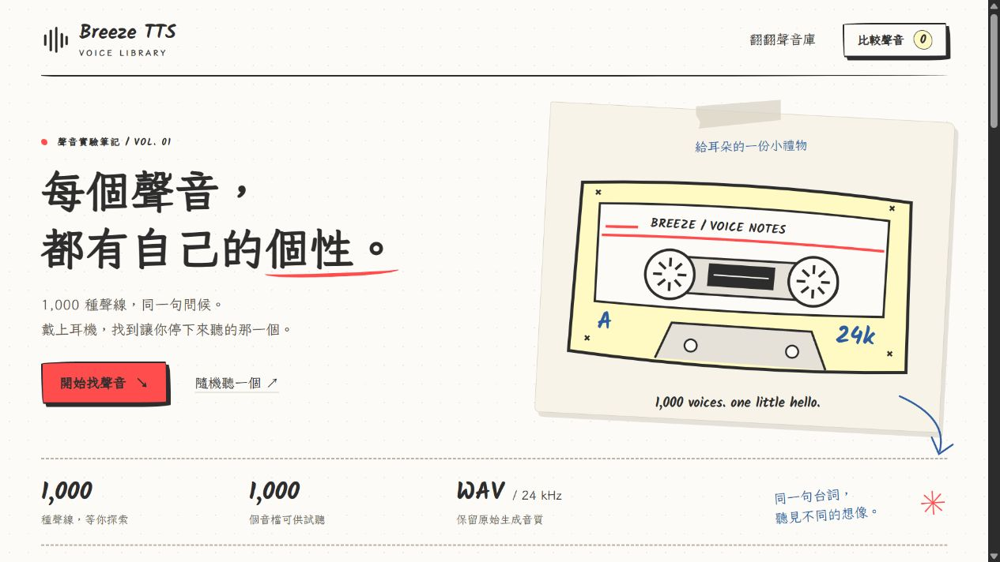

# 實際交付驗收 — 2026-10-15

**網站與單一 Repo 部署檔案已完成；本機實測通過；尚未建立 GitHub 遠端或公開 Pages 網址。**

## 十項驗收

| 項目 | 實際結果 |
|---|---|
| 單一 Repo | 本交付資料夾只有一個 `.git`，分支 `main`；沒有第二個 Repo、submodule 或 remote。由持有者連接唯一的空白 GitHub Repo。 |
| 完整網站原始碼 | `index.html`、CSS、JS、本地字型／授權、SVG、索引、工具、測試與 Actions 均已存在。 |
| 全部 WAV | `output/` 實際 1,000 個 WAV。全部與原 TTS 來源逐檔比對大小及 SHA256，一致；未修改、轉碼或重新生成。 |
| JSON 索引數量 | `data/voices.json` 1,000 筆，1,000 個唯一 ID；全部沿用已有繁中描述、原文與聲線特徵。 |
| 每筆音訊路徑 | 1,000 筆路徑均對應真實檔案，且在帶 `/breeze-test/` 前綴的靜態 HTTP 網站逐筆 HEAD 得到 200 與正確 Content-Length。 |
| GitHub 單檔限制 | WAV 合計 560,581,760 bytes；最大 `tts-design-0091.wav` 為 1,651,280 bytes。超過 100 MiB：0 個。沒有 Git LFS 指標。 |
| Pages 相容性 | 實際打包 1,011 個必要網站檔案、562,710,434 bytes（536.64 MiB）。子路徑預覽成功；**GitHub Actions / GitHub Pages 真實公開部署尚未執行**。 |
| 功能 | 搜尋、篩選、排序、分頁、真實 WAV 播放／暫停、進度跳轉、音量、單檔下載、比較及重試通過下列瀏覽器實測。 |
| 額外依賴 | 沒有第二個 Repo、外部音訊儲存、付費資料庫或正式後端；訪客只載入同一靜態站的 HTML/CSS/JS/JSON/字型，按播放才載入 WAV。 |
| 操作說明 | README 包含建立空白 Public Repo、GitHub Desktop／Git 上傳、Pages GitHub Actions Source、初次失敗時重跑、網址及必要手動操作。 |

## 已執行的檢查

- `node --check assets/js/app.js`：通過。
- `python scripts/generate_voice_index.py --check`：通過，驗證 1,000 個 RIFF WAV、24 kHz、正長度、大小、原始 SHA256、路徑及索引一致。
- `python -m unittest discover -s tests -v`：4 項通過。涵蓋非連號／中文／空格／特殊字元檔名與中繼資料缺失、音檔遺失、原音檔變更、Git LFS 指標／無效 WAV 拒收。
- `python scripts/build_site.py`：通過，僅打包白名單公開檔案；不執行原 TTS 程式。變更字型後使用全新 staging 重新建置成功。
- 實際候選提交檔案未包含模型、虛擬環境、測試快取或本機使用者絕對路徑；未找到檢查規則涵蓋的 GitHub Token／私鑰格式。這不是對所有可能秘密的形式證明。

## 真實瀏覽器實測

使用 Chromium 的 Codex 內嵌瀏覽器，測試打包後的靜態網站，並非僅以假資料測試。

| 測試 | 實際觀察 |
|---|---|
| 首次載入 | 統計 1,000／1,000；只渲染當頁 12 張卡，頁數 84；播放器沒有 src。服務記錄確認首頁及搜尋期間 WAV 請求為 0。 |
| 中文描述搜尋 | 「沙啞」得到 289 筆；再選女性聲線得到 85 筆。 |
| 篩選／排序 | 女性聲線結果均為女性標記；長度由長至短正確。低音＋非人類得到 29 筆。編號倒序第一筆為 1000。 |
| 檔名搜尋 | `tts-design-1000.wav` 得到對應唯一記錄。 |
| 無結果 | 不存在的關鍵字顯示友善提示；清除後恢復完整列表。 |
| 分頁 | 第 2 頁第一筆為 0013，顯示 13–24；可返回第 1 頁。 |
| 真實播放 | 0001 WAV 載入成功，長度 4.72 秒、狀態「播放中」；切換 0002 為 8.08 秒。全頁只有一個 `<audio>`。 |
| 暫停／進度 | 0002 暫停成功；點擊進度中間後實際 `currentTime` 約 4.048 秒，介面顯示 `0:04 / 0:08`。 |
| 音量 | 鍵盤調整音量滑桿，頁面所有卡片的共同音量值同步更新。 |
| 下載 | 實際下載 0001.wav，SHA256 與原 WAV 一致：`d3160bb917c2f973fb0cf5a1ab75f86f6d5f95a489998b6005e5b236ac83104b`。 |
| 比較 | 0001、0002 同時列入對話框，對話框內可真實播放；重新載入仍保留選擇。可加入 4 個，第 5 個會提示上限，可清空。 |
| 完整描述／隨機試聽 | 可展開原文與資料；隨機選到 0168、正確顯示並播放對應 WAV。 |
| 音檔錯誤 | 測試服務故意讓一次 WAV 請求回 404，網站顯示錯誤；按重試後載入真實 WAV 並恢復播放。其他記錄可使用。 |
| 索引錯誤 | 故意讓 JSON 一次回 503，顯示明確錯誤；按重新載入後恢復 1,000 筆。 |
| 中繼資料缺失 | 以測試回應移除前兩筆描述／profile，出現「尚未提供聲音描述」，其餘列表正常、仍只渲染 12 張。 |
| 響應式 | 桌面 1,280 px 為三欄、平板 768 px 為兩欄、手機 390 px 為單欄；未發現水平溢出。手機比較對話框正常。 |
| 瀏覽器錯誤 | 最後正常網站頁面 console error 為空；故障注入時預期的 HTTP 錯誤另外測試。 |

音訊跳轉測試使用支援 HTTP Range 的測試靜態伺服器；最初不支援 Range 的 Python 簡易伺服器不能可靠跳轉，因此補齊測試服務的 Range 支援後再驗證。沒有因測試問題改動或重新生成 WAV。測試故障只存在於被 Git 忽略的 `.qa`，不進入公開網站或部署。

## 尚未實際驗證的範圍

未建立／推送 GitHub 遠端、未在你的帳號上跑 Actions、未取得或開啟真實 Pages 網址，因此不能宣稱已公開上線。你仍需依 README 完成這些帳號操作。未測試 Safari／Firefox 或真實 iOS 裝置；正式 Pages 的網路、帳號政策、流量及排程由 GitHub 控制。

原始 WAV 為 IEEE float WAV；此瀏覽器已實際解碼成功。其他瀏覽器若解碼失敗，頁面提供清楚錯誤、重試與原檔下載；本交付遵守不修改 WAV 的要求。

## 視覺預覽

[完整桌面頁面截圖](docs/preview-desktop.png)。截圖僅供檢視，Actions 不把 docs 或測試工具放進公開 artifact。
